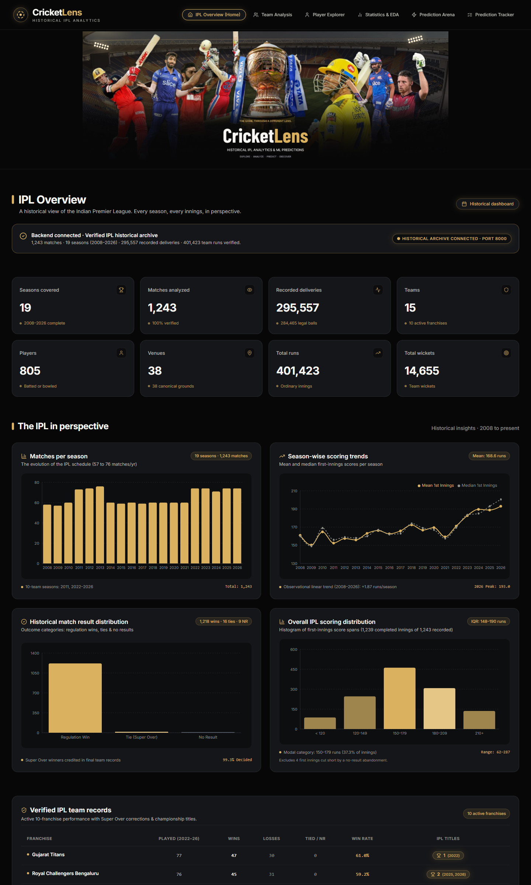
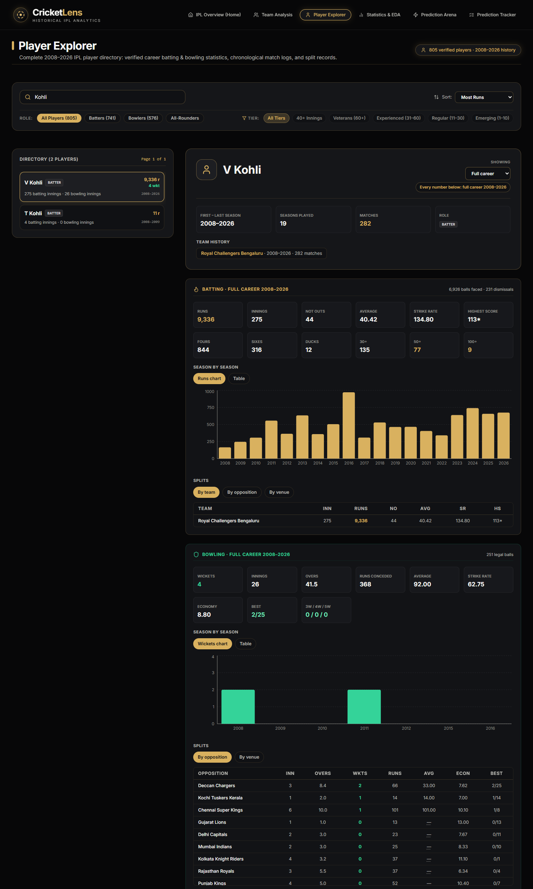
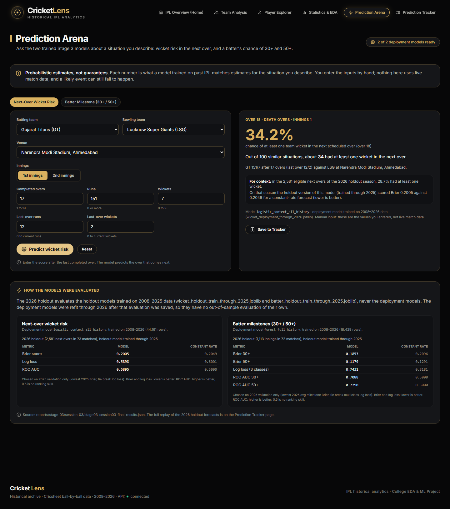
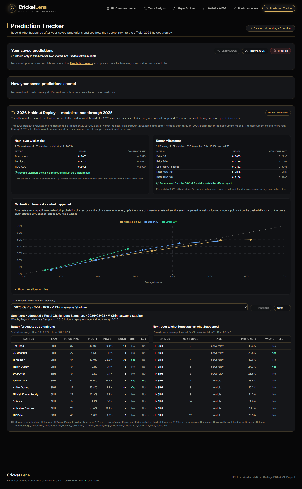
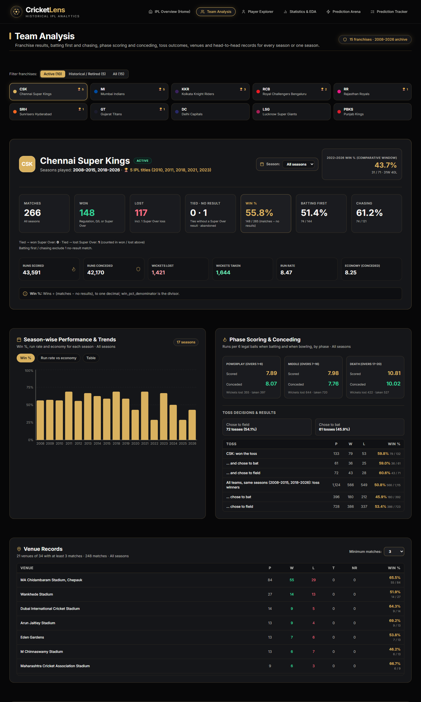
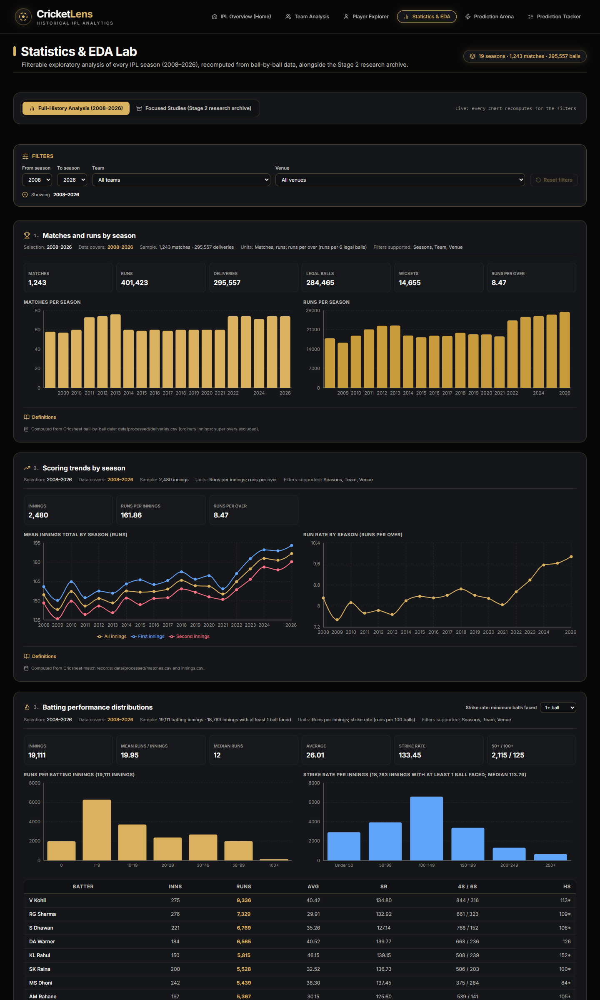
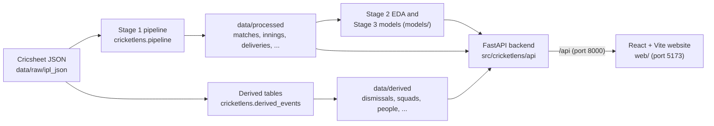

# CricketLens — Men's IPL Analytics & Prediction

CricketLens is an IT462 Exploratory Data Analysis course project. It cleans and audits every men's Indian
Premier League match from 2008 to 2026 from Cricsheet ball-by-ball data, explores it systematically, trains
two probability models, and serves all of it through a FastAPI backend and a six-tab React website:
season and team analysis, a player explorer, a filterable statistics lab, next-over wicket and batter
milestone predictions, and a tracker that scores predictions and replays the models' 2026 holdout season.

## Contents

1. [Features](#features)
2. [Screenshots](#screenshots)
3. [Data source](#data-source)
4. [Architecture](#architecture)
5. [Repository structure](#repository-structure)
6. [Setup and run](#setup-and-run)
7. [Deploying to Vercel](#deploying-to-vercel)
8. [Reproducing the analysis stages](#reproducing-the-analysis-stages)
9. [Key definitions](#key-definitions)
10. [Machine-learning models](#machine-learning-models)
11. [Verification approach](#verification-approach)
12. [Limitations and known issues](#limitations-and-known-issues)
13. [Project stages](#project-stages)
14. [License and credits](#license-and-credits)

## Features

**IPL Overview (home)**
- Archive figures: seasons, matches, deliveries, teams, players, venues, runs and wickets, each with its definition.
- Matches and first-innings scoring by season with a fitted trend, the result distribution and a first-innings score histogram.
- Team records of the ten current franchises over their shared seasons (2022–2026), with every season's champion.

**Team Analysis**
- Any franchise, for all seasons or one season: results with Super Over and no-result handling, batting first vs chasing, toss outcomes, phases and season trends.
- Records against every opponent, head-to-head between any two franchises and venue records with a minimum-matches filter.

**Player Explorer**
- Directory of 805 players keyed by Cricsheet registry ID, searchable by any name variant, with role and experience filters.
- Career or single-season profiles: batting and bowling summaries, season charts, splits by team, opposition and venue, and a paginated match log.

**Statistics & EDA**
- Full-history analysis that recomputes for a season range, team and venue: scoring trends, phases, batting and bowling distributions, venues, toss, innings order, dismissals, boundaries, anomalies and correlations.
- Player comparison, plus the static Stage 2 research figures with their coverage stated.

**Prediction Arena**
- Next-over wicket risk from a match situation you enter, and a batter's chance of 30+ and 50+ for a future match.
- Results in plain language, with the 2026 base rate and model scores for context; warnings when inputs fall outside anything seen at that stage of an innings.

**Prediction Tracker**
- Save predictions in the browser, record what happened, and see Brier scores and hit rates; export and import as JSON.
- 2026 Holdout Replay: every forecast the holdout models made for 2026, match by match, with calibration charts.

## Screenshots

| IPL Overview | Player Explorer (V Kohli) |
|---|---|
|  |  |
| **Prediction Arena (next-over wicket risk)** | **Prediction Tracker (2026 holdout replay)** |
|  |  |
| **Team Analysis** | **Statistics & EDA** |
|  |  |

Mobile (390px): [IPL Overview](docs/screenshots/mobile-01-overview.png) ·
[Player Explorer](docs/screenshots/mobile-03-player-explorer.png) ·
[Prediction Arena](docs/screenshots/mobile-05-prediction-arena.png)

## Data source

All data comes from [Cricsheet](https://cricsheet.org/)'s IPL ball-by-ball JSON, which is stored in
`data/raw/ipl_json/`. Thanks to Cricsheet for making it freely available.

| Archive | Count |
|---|---:|
| Matches | 1,243 (18 April 2008 to 31 May 2026) |
| Seasons | 19 (2008–2026) |
| Ordinary innings | 2,480 |
| Ball events (Super Overs excluded) | 295,557, of which 284,465 legal deliveries |
| Runs | 401,423 (extras included) |
| Team wickets | 14,655 |
| Franchises | 15 (10 active in 2026, 5 defunct) |
| Players (registry IDs who batted or bowled) | 805 |
| Canonical venues | 38 |
| No-result matches | 9 |
| Matches decided by a Super Over | 16 |

The processed tables are in `data/processed/` and the supplementary tables (dismissal kinds, squads,
registry IDs, substitutions) in `data/derived/`. Both are committed, so the website and tests run from a
fresh clone; `data/processed/README.md`, `data/derived/README.md` and `docs/DATA_DICTIONARY.md` describe
them.

## Architecture



The backend loads the tables once into a single analytics engine and computes every statistic from them;
apart from the captions of the static Stage 2 research figures, no number on the website is typed into the
code. The prediction endpoints call the Stage 3
inference functions with the saved models.

| Endpoint group | What it serves |
|---|---|
| `/api/health` | Status, archive extent and model availability |
| `/api/overview/*` | Homepage figures, charts, team records and champions |
| `/api/teams/*` | Franchise list, team overview, venues, head-to-head |
| `/api/players/*` | Player directory, profiles, match logs |
| `/api/eda/*` | Filterable analysis, filter options, player comparison, Stage 2 figures and tables |
| `/api/predict/*` | Prediction options, wicket and batter predictions, model evaluation, 2026 holdout replay |

The full endpoint reference is in [`docs/STAGE_04_WEBSITE.md`](docs/STAGE_04_WEBSITE.md); interactive docs
are at `http://127.0.0.1:8000/docs` while the backend runs.

## Repository structure

```
data/raw/ipl_json/     Cricsheet IPL ball-by-ball JSON (source data)
data/processed/        Stage 1 tables and the Stage 3 training tables
data/derived/          Dismissals, squads, registry IDs and substitutions from the raw JSON
src/cricketlens/       Stage 1-3 Python modules (pipeline, EDA, model training and inference)
src/cricketlens/api/   FastAPI application: routes, schemas and services
api/                   Vercel function entrypoint and its runtime requirements
vercel.json            Vercel build, rewrites and function configuration
models/                The four trained models (2026 deployment and 2025 holdout versions)
web/                   React + TypeScript + Vite + Tailwind website
tests/                 pytest suite
reports/               Stage reports (PDF), figures and evaluation outputs
notebooks/             Stage 2 EDA notebooks
docs/                  Stage documentation, data dictionary, website guide, screenshots
pyproject.toml         Python package and dependencies
LICENSE_NOTES.md       Data credit and image-rights notes
```

## Setup and run

Requirements: **Python 3.11 or newer** and **Node.js 18 or newer** with npm (tested with Python 3.14 and
Node.js 22). Run every command from the repository root unless a step says otherwise.

### 1. Python environment

Windows PowerShell:

```powershell
python -m venv .venv
.\.venv\Scripts\python.exe -m pip install --upgrade pip
.\.venv\Scripts\python.exe -m pip install -e ".[dev]"
```

macOS / Linux:

```bash
python3 -m venv .venv
.venv/bin/python -m pip install --upgrade pip
.venv/bin/python -m pip install -e ".[dev]"
```

The saved models were serialised with scikit-learn 1.8.0, which `pyproject.toml` pins.

### 2. Backend (port 8000)

The backend finds `data/`, `models/` and `reports/` from the package location, so it works from any
directory (set `CRICKETLENS_ROOT` to point it at another copy of them). From the repository root:

```powershell
# Windows PowerShell
.\.venv\Scripts\python.exe -m uvicorn cricketlens.api.app:app --host 127.0.0.1 --port 8000
```

```bash
# macOS / Linux
.venv/bin/python -m uvicorn cricketlens.api.app:app --host 127.0.0.1 --port 8000
```

Check it at `http://127.0.0.1:8000/api/health`; the first requests take a few seconds while the data loads.

### 3. Frontend (port 5173)

In a second terminal:

```bash
cd web
npm ci
npm run dev
```

Open `http://localhost:5173`. The dev server forwards `/api` requests to the backend on port 8000.
`npm run build` type-checks and builds a production bundle into `web/dist/`.

### 4. Tests

```powershell
.\.venv\Scripts\python.exe -m pytest        # Windows PowerShell
```

```bash
.venv/bin/python -m pytest                  # macOS / Linux
```

Type-check the website with `npx tsc --noEmit` in `web/`.

### 5. Optional: rebuild the derived tables

`data/derived/` is committed. To rebuild it from the raw JSON (the output is byte-identical; the SHA256 of
each file is listed in `data/derived/README.md`):

```bash
python -m cricketlens.derived_events --raw data/raw/ipl_json --output data/derived
```

Use the virtual environment's Python (`.\.venv\Scripts\python.exe` or `.venv/bin/python`) for this and the
commands below.

## Deploying to Vercel

The repository deploys as **one Vercel project**: the React build is served as static files and the FastAPI
app runs as a Python Vercel Function under `/api` on the same domain, so no CORS setup is needed. Everything
is configured in the repository:

| File | What it does |
|---|---|
| `vercel.json` | Framework "Other"; build `cd web && npm ci && npm run build`; output `web/dist`; rewrites `/api/*` to the function and every other path without a file extension to `/index.html`; the function's files and a 60 s maximum duration |
| `api/index.py` | The function: imports the existing app from `src/cricketlens/api/app.py` |
| `api/requirements.txt` | Only the packages the API imports at runtime, pinned (scikit-learn 1.8.0 for the saved models) |
| `api/.python-version` | Python 3.14 |

The function contains only the files the API reads: the 11 tables in `data/processed` and `data/derived`
that it uses, the two deployment models, the Stage 1–3 report tables it serves and the 20 Stage 2 figures.
`data/raw`, notebooks, docs, tests and the website sources are excluded.

> **Before a public deployment:** a Vercel deployment is reachable by anyone with its URL. The homepage
> hero artwork's image rights were not verified (see `LICENSE_NOTES.md`), so keep the deployment
> protected or replace the artwork first.

### Environment variables

None are required. Optional:

| Variable | When to set it |
|---|---|
| `CORS_ALLOW_ORIGINS` | Only if a frontend on another origin calls this API: comma-separated origins, e.g. `https://example.com`. Not needed on Vercel, where the site and the API share one origin. |
| `VITE_API_BASE_URL` | Only for a frontend built separately from the API: the API's absolute base, e.g. `https://api.example.com/api`. Read at build time. |
| `CRICKETLENS_ROOT` | Only to read `data/`, `models/` and `reports/` from another directory. Not needed on Vercel. |

### (a) Vercel dashboard, imported from GitHub

1. The owner of `Bhagy25/IPL_Predictor` must authorise the Vercel GitHub app for the repository (on the
   Vercel import screen, or in GitHub under Settings → Applications), or the repository will not appear in
   Vercel's list.
2. In Vercel: **Add New… → Project**, and import `IPL_Predictor`.
3. On the configuration screen, leave **Root Directory** as the repository root (`./`) and leave the
   Framework Preset, build and output settings alone: `vercel.json` sets them. Add no environment variables.
   Select **Deploy**.
4. A new project's production branch is `main`, which does not contain this configuration, so the first
   deployment builds the wrong branch. Open **Settings → Environments → Production → Branch Tracking**, set
   the branch to `feature/cricketlens-final` and select **Save**.
5. Open **Deployments → Create Deployment**, enter the branch `feature/cricketlens-final` and select
   **Create Deployment**. From then on every push to that branch creates a production deployment, and
   pushes to other branches create preview deployments.

### (b) Vercel CLI from a local clone

Deploy from a fresh clone, so that nothing outside the repository (such as `.venv/` or `node_modules/`) is
uploaded:

```bash
git clone --branch feature/cricketlens-final https://github.com/Bhagy25/IPL_Predictor.git
cd IPL_Predictor
npm i -g vercel        # or run each command as `npx vercel`
vercel login
vercel                 # links or creates the project, then deploys (a new project's first deployment is production)
vercel --prod          # later production deployments; plain `vercel` creates preview deployments
```

When `vercel` asks about the project settings, keep the code directory `./` and do not override the
settings: `vercel.json` provides them.

### Verify a deployment

1. Open `https://<your-deployment>/api/health`. Expect `"status": "healthy"`, `"archive_matches": 1243`,
   `archive.first_match_date` `"2008-04-18"` and `archive.last_match_date` `"2026-05-31"`,
   `derived_tables.available: true`, and `prediction_models.wicket.available` and
   `prediction_models.batter.available` both `true`. A JSON 404 or the website's HTML here means the
   `/api` rewrite or the function is not working; `"degraded"` names the missing data or model.
2. Open the site and refresh on a deep link such as `/players` or `/tracker`: the page must load, not a
   404.
3. Make a wicket and a batter prediction in the Prediction Arena.
4. The first request after a deployment or an idle period starts the function and loads the data; expect
   several seconds before it answers. Later requests are fast.

### Measured limits

Measured locally for this configuration (Vercel's own numbers will differ somewhat):

| Measure | Result | Vercel limit |
|---|---|---|
| Function bundle, uncompressed (Linux wheels for Python 3.14 plus the included files) | 384.9 MB (330.3 MB packages, 54.6 MB data, models, figures and code) | 500 MB for Python |
| Memory of the API process | 187 MB at start, 237 MB with all data loaded, 260 MB after 1,161 requests; peak 340 MB | 2 GB (Hobby) |
| Cold start: process start to first response | median 7.4 s for `/api/overview/summary`, 8.7 s for a player profile (three runs each) | 60 s set (300 s maximum on Hobby) |
| Largest response body (every endpoint and the main parameter variants) | 0.16 MB (`/api/predict/options`) | 4.5 MB |

## Reproducing the analysis stages

The outputs of every stage are committed; these commands regenerate them. Each module accepts `--help`.

**Stage 1 — screening and cleaning**

```bash
python -m cricketlens.stage01_review data/raw/ipl_json --output reports/stage_01
python -m cricketlens.pipeline data/raw/ipl_json --output data/processed
python -m cricketlens.data_audit --data data/processed --output reports/stage_01 --figures reports/figures
```

**Stage 2 — systematic EDA** (Sessions 01–03)

```bash
python -m cricketlens.stage02_eda --data data/processed --output reports/stage_02/session_01 --figures reports/figures/stage_02
python -m cricketlens.stage02_deep_eda --data data/processed --output reports/stage_02/session_02 --figures reports/figures/stage_02
python -m cricketlens.stage02_final_eda --data data/processed --output reports/stage_02/session_03 --figures reports/figures/stage_02
```

**Stage 3 — models.** Sessions 01–02 were development experiments (train through 2024, validate on 2025):
`wicket_training_data`, `fit_wicket_models` and `stage03_diagnostics` for the wicket model;
`batter_training_data`, `fit_batter_models` and `stage03_batter_diagnostics` for the batter model. The final
models come from Session 03:

```bash
# Selects on 2025, scores the 2026 holdout once, then refits through 2026.
# It overwrites models/ and reports/stage_03/session_03/, so run it only to reproduce Stage 3.
python -m cricketlens.stage03_full_history

# Manual predictions from the command line, with the deployment models
python -m cricketlens.predict_wicket --model models/wicket_deployment_through_2026.joblib --help
python -m cricketlens.forecast_future_batter --help
```

Stage write-ups are in `docs/` (for example `docs/STAGE_03_SESSION_03_FULL_HISTORY.md`) and the stage
reports in `reports/*.pdf`.

## Key definitions

- **Results.** A win counts regulation wins, D/L wins and Super Over wins after a tie; a tie decided by a
  Super Over is also reported separately. A tie with no Super Over result is neither a win nor a loss.
- **Win %** = wins ÷ (matches − no results), to one decimal with halves rounded up. No-result (abandoned)
  matches are excluded from win percentages and from batting-first / chasing records.
- **Super Overs** decide the winner but their balls are excluded from every batting, bowling and team
  statistic.
- **D/L.** D/L-marked results count normally in descriptive statistics. Both models exclude D/L-marked
  matches from training and evaluation, and the batter model also excludes no-result matches.
- **Team wickets** are every dismissal except retired hurt and retired not out.
- **Bowler-credited wickets:** bowled, caught, caught and bowled, lbw, stumped and hit wicket. Run outs,
  retirements and obstructing the field are not credited to the bowler.
- **Batting innings:** one per innings in which the player was at the crease as striker or non-striker, or
  was dismissed, so a non-striker run out without facing a ball is an innings and a dismissal.
- **Duck:** dismissed for 0, including without facing a ball; retired hurt on 0 is not a duck.
- **Batting average** = runs ÷ dismissals; shown as unavailable (not 0) when never dismissed.
  **Strike rate** = runs per 100 balls faced (wides excluded).
- **Phases:** powerplay overs 1–6, middle overs 7–16, death overs 17–20.
- **Roles:** a player bowls regularly when they bowl in at least half their matches with at least 12 legal
  balls per bowling innings, and bats regularly when they bat in at least half their matches facing at
  least 8 balls per innings. Both make an all-rounder; if neither applies, the player is a bowler when they
  bowled more legal balls than they faced, otherwise a batter.
- **First-innings score histogram:** completed first innings only, meaning the second innings started,
  ten wickets fell or 120 legal balls were bowled (1,239 of 1,243; four first innings ended by no result
  are excluded).
- **Champion:** the winner of each season's final (its last match).
- **Franchise renames** are merged: Delhi Daredevils → Delhi Capitals, Kings XI Punjab → Punjab Kings,
  Royal Challengers Bangalore → Royal Challengers Bengaluru, Rising Pune Supergiants → Rising Pune
  Supergiant. Deccan Chargers and Sunrisers Hyderabad stay separate.

## Machine-learning models

| | Next-over wicket model | Batter milestone model |
|---|---|---|
| Predicts | P(at least one team wicket in the next over) | P(30+ runs) and P(50+ runs), from one three-class model so P(50+) ≤ P(30+) |
| Algorithm | Logistic regression (`logistic_context_all_history`) | Random forest (`forest_full_history`) |
| Inputs | Innings, completed overs, runs, wickets, run rate, last over's runs and wickets, batting and bowling team, phase, venue | Past-only form (career, last 5 and last 10 innings, record against the opponent and at the venue, days since the last innings) plus batting team, opponent and venue |
| Eligible rows (2008–2026) | 44,161 next-over checkpoints | 18,429 batter innings |

**Sequence.** Candidates were trained on 2008–2024 and compared on 2025 only, then the selected model was
refit on 2008–2025 and scored **once** on the untouched 2026 season. After that test, a deployment model was
refit on all of 2008–2026. The website's predictions use the deployment models; the 2026 numbers below
evaluate the holdout models, since the deployment models have no out-of-sample test of their own.

**2026 holdout results** (from `reports/stage_03/session_03/stage03_session03_final_results.json`; lower
Brier and log loss are better, ROC AUC 0.5 means no ranking skill):

| Model | Metric | Model | Constant-rate baseline |
|---|---|---:|---:|
| Next-over wicket (2,581 checkpoints, 73 matches) | Brier score | 0.2005 | 0.2049 |
| | Log loss | 0.5898 | 0.6001 |
| | ROC AUC | 0.5895 | 0.5000 |
| Batter milestones (1,113 innings, 72 matches) | Brier 30+ | 0.1853 | 0.2096 |
| | Brier 50+ | 0.1179 | 0.1291 |
| | Log loss (3 classes) | 0.7431 | 0.8181 |
| | ROC AUC 30+ / 50+ | 0.7088 / 0.7290 | 0.5000 / 0.5000 |

In 2026, 28.7% of eligible next overs had at least one wicket; 29.5% of eligible batter innings reached 30
and 15.0% reached 50.

## Verification approach

- Statistics shown on the website are checked against independent calculations: tests recompute expected
  values with pandas from `data/processed`, from `data/derived` or directly from the raw JSON, without the
  backend's own code.
- Prediction endpoints are checked against direct calls of the Stage 3 inference functions, and the replay
  metrics are recomputed from the per-example holdout forecasts and compared with the official report.
- Guard tests stop numbers from being typed into the homepage or health endpoint, and the model files'
  SHA256 is checked before and after the test run.
- Run the suite with `pytest` (395 tests at the time of writing). Website behaviour was checked in a
  browser at 1440px and 390px widths, including the production build behind the same rewrites as on Vercel.

## Limitations and known issues

- **The wicket model is only slightly better than a constant rate** (2026 Brier 0.2005 vs 0.2049, ROC AUC
  0.59): treat its probabilities as broad context, not sharp forecasts.
- **Batter forecasts are conditional on the player batting.** Selection in the playing XI and batting
  position are not predicted, and a forecast for a player without a 2026 appearance assumes they play again.
- **Manual inputs, no live data.** Predictions use only what you enter; inputs outside the observed range
  for that stage of an innings are flagged as extrapolations.
- **Tracker data stays in your browser** (localStorage); it is not shared or used to retrain the models.
- **Hero artwork:** the homepage collage uses press photographs whose image rights were not verified; it is
  included for academic demonstration only (see `LICENSE_NOTES.md`).
- **npm audit** reports 2 moderate advisories in react-router 6 (an open redirect through a backslash in
  links, and an issue in server-side rendering hydration). The site uses only fixed internal links and no
  server-side rendering, so neither is reachable here; the fix needs a major upgrade to react-router 7.
- **Data limitations:** Cricsheet records 4 overs with seven legal balls and 4 with none, which are kept as
  recorded and excluded from model checkpoints after them; city is missing for some Dubai and Sharjah
  matches; one player appears only at the non-striker's end; and two different people share the name
  "Harmeet Singh", which the registry IDs keep apart.
- The static Stage 2 research figures cover 2008–2025 or 2018–2025, as labelled: Stage 2 deliberately left
  2026 out while it was reserved as the models' test season. Every live statistic includes 2026.

## Project stages

| Stage | Work | Status |
|---|---|---|
| 1 | Screen, clean, standardise and audit the IPL data | Complete |
| 2 | Systematic EDA, descriptive statistics, figures and interpretation | Complete |
| 3 | Train, validate and test both models; 2026 holdout; deployment refit | Complete |
| 4 | Six-tab React website | Complete |
| 5 | FastAPI integration, predictions, tracker and historical replay | Complete |
| 6 | Final academic report and demonstration | In progress |

See [`docs/ROADMAP.md`](docs/ROADMAP.md) and the `docs/STAGE_0*_STATUS.md` files for detail.

## License and credits

Match data: [Cricsheet](https://cricsheet.org/). See [`LICENSE_NOTES.md`](LICENSE_NOTES.md) for data
credit, licence notes and image rights.
