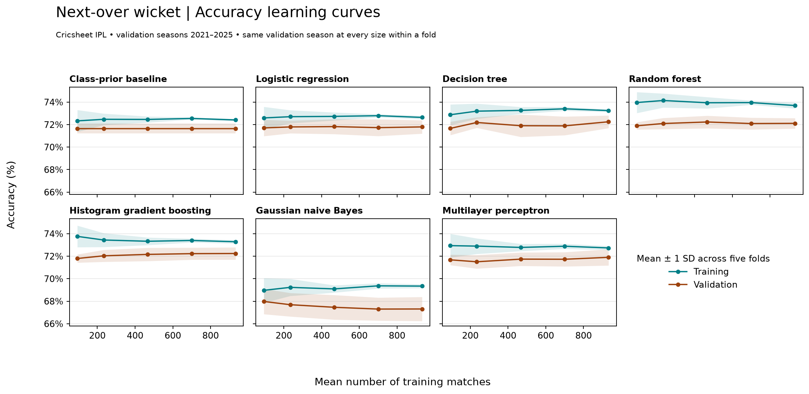
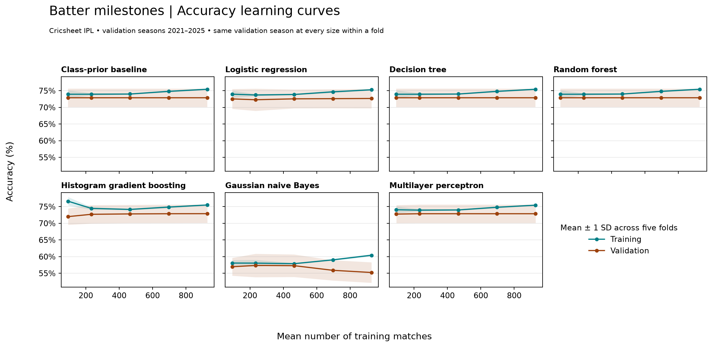

# CricketLens — Living IT462 EDA project report

**Current prediction-model methods and results** appear in [Section 8](#8-chronological-prediction-model-benchmark), and the **final model decision** in [Section 8.9](#89-final-model-decision). The complete methodology, with the assumption evidence for every algorithm, is in [docs/MODEL_METHODOLOGY.md](../docs/MODEL_METHODOLOGY.md). Sections 1–7 and the dated stage notes record the project’s development. Section 8 uses the verified final data counts, model definitions and evaluation results.

## 1. Project definition and scope (agreed)

Analyze men's Indian Premier League data, season-by-season and across players/venues/teams, using statistical EDA. Provide two eventual ML tools: (A) pre-match probability of 30+ and 50+ batter runs, and (B) the probability at least one batting-team wicket falls during the next six-legal-delivery over. The final website will present six sections (Overview, Teams, Players, Statistics & EDA Lab, Prediction Arena, Prediction Tracker), with no login and no automatic retraining.

**Data source:** [Cricsheet](https://cricsheet.org/), match-by-match structured JSON, supplied locally as `ipl_json (1).zip`, 1,243 match files, 2008–2026. Cite Cricsheet according to its dataset license; see `LICENSE_NOTES.md`. Confirm with the professor how the syllabus's `data.gov.in` collection clause applies to a Cricsheet-based project.

## 2. Stage 1 — Dataset screening and cleaning: measured findings (provisional)

### 2.1 Data structure and dimensions

| Cleaned table | Rows | Meaning |
|---|---:|---|
| `matches.csv` | 1,243 | One men's IPL match each |
| `innings.csv` | 2,480 | Ordinary team batting innings (not Super Overs) |
| `overs.csv` | 47,756 | Recorded regular innings overs, including partial overs |
| `deliveries.csv` | 295,557 | Recorded ball events including wides and no-balls |
| `batter_innings.csv` | 18,768 | One player batting appearance per innings |
| `next_over_samples.csv` | 44,714 | Eligible checkpoint-known next-over outcomes |
| `screening_issues.csv` | 562 | Issue *records*, including censored windows and anomalies |

Date coverage is 2008-04-18 to 2026-05-31. The JSON is entirely labeled `male` and `Indian Premier League`. Runs are ratio/discrete; team/venue are nominal; over number is an ordered match-progress variable. Match/date and season are necessary to enforce chronological ML training.

### 2.2 Cricket-specific cleaning decisions

1. Standardize genuine franchise renames: Delhi Daredevils -> Delhi Capitals, Kings XI Punjab -> Punjab Kings, Royal Challengers Bangalore -> Royal Challengers Bengaluru, and Rising Pune Supergiants -> Rising Pune Supergiant. Do not falsely merge unrelated discontinued teams with current ones.
2. A wide or no-ball is an *illegal* delivery; a no-ball can still count as a ball faced by the batter, while a wide does not. Batting runs differ from total innings runs because of extras.
3. Wickets count batting-team losses, excluding `retired hurt`; `retired out` counts as a wicket. Ordinary innings exclude Super Overs.
4. Eligible next-over samples require a full 6-legal-ball **current** over. Label the next over only if it has exactly six legal balls, or if it finishes early with a confirmed all-out causing a known positive. Other shortened future overs are censored and omitted. Anomalous future overs with >6 legal balls are excluded.
5. The archive has 550 censored next-over windows, 4 over records with >6 legal balls, 4 with zero legal balls, and 4 rejected future-over windows; these issue categories overlap. Further investigation into anomalies and D/L matches is needed before a final dataset is frozen.
6. Aggregated per-innings team runs, wickets and legal-ball counts reconcile perfectly to delivery-level sums for all 2,480 ordinary innings.

### 2.3 Missingness and limitations

`city` is missing in 51 matches (4.10%). `winner` is empty in 25 records because 16 matches are ties and 9 are no-results—not all missing values indicate error. `outcome_method` is ordinarily blank except for the 23 recorded D/L outcomes and is structurally optional. All records include a venue, though venue aliases are not fully standardized yet. The MCAR/MAR/MNAR mechanisms cannot be established merely from these counts; they require careful contextual investigation and remain unproven.

**Sampling:** The dataset is an archive of available historical IPL matches, not a random sample of all possible future IPL match situations. Historical eras, changing franchise composition, venue conditions, and censored innings may bias conclusions.

## 3. Preliminary Stage 2 — First descriptive EDA (measured, not inferential)

- **401,423** total team runs and **14,655** batting-team wickets appear in ordinary delivery records; **284,465** legal deliveries.
- Recorded first-innings totals have **mean 168.57 runs** and **median 168 runs** across archive history. This is descriptive, not adjusted for changing eras, reduced overs, venues or D/L.
- Among **18,768 observed batting appearances**, **25.53%** scored 30+ and **11.27%** scored 50+. These are historical frequencies, not calibrated pre-match forecasts.
- Of **44,714** eligible next-over windows, roughly **27.70%** include at least one team wicket. The conditional definition excludes censored future overs, and is not necessarily representative of all match states.
- Early EDA figures: `figures/matches_by_season.png`, `figures/average_first_innings_runs.png`, `figures/first_innings_distribution.png`, `figures/wicket_next_over_by_checkpoint.png`. Supporting CSVs and audit JSON are in `reports/stage_01/`.

**Interpretation pending:** Add exact distribution summary (IQR, MAD, SD, outliers), team/venue differences, uncertainty and season-trend controls before making substantive cricket claims.

## 4. Preliminary Stage 3 — First next-over wicket ML baseline (2025 validation only)

Initial logistic-regression classifier uses checkpoint-known runs, wickets, completed overs, run rate, innings number, batting team and bowling team. Training uses match seasons **2008–2024** (39,503 windows) and development validation uses **2025** (2,596 windows). It does not use 2026 outcomes for training, tuning, or model performance assessment.

| Evaluation on 2025 | Logistic regression | Constant historical event-rate baseline |
|---|---:|---:|
| Brier Score (lower better) | 0.19831 | 0.20319 |
| Log loss (lower better) | 0.58561 | 0.59638 |
| ROC-AUC | 0.59223 | 0.50000 |

The model shows **only a modest improvement** on this validation year. These metrics do not imply accurate forecasts for every over, and no final algorithm has yet been selected. Further feature engineering must use information known only before each corresponding checkpoint. The **2026 holdout** will be scored once after model design is fixed; only afterward may the selected model be refitted through 2026 for future use. The batter milestone model has not been developed yet.

## 5. Syllabus alignment and planned EDA (not yet completed)

- Explicit measurement scales, sampling biases, missingness and MCAR/MAR/MNAR treatment.
- Five-number summaries, central tendency, variance, standard deviation, IQR, MAD and coefficient of variation.
- Histograms, box/violin plots, team comparisons, wicket phase trends, venue effects, crosstabs, heatmaps.
- Pearson/Spearman correlations, multiple linear regression/goodness of fit, potential multicollinearity/VIF, time trends and optional PCA/profiling.
- Statistical interpretations and caveats in both report and dashboard, not just charts.

## 6. Dashboard plan (not yet implemented)

1. **IPL Overview** — totals, scoring distributions, season trends, filters.
2. **Teams** — selected-franchise performance, opposition head-to-head, venue/phase comparisons.
3. **Players** — batting/bowling explorer, milestones and recent form.
4. **Statistics & EDA Lab** — IPL-wide distributions with team/venue/season filters, correlations and variability.
5. **Prediction Arena** — two model forms and probability outputs.
6. **Prediction Tracker** — store original probability, context, model version and actual outcome; Brier/calibration across both successful and unsuccessful events; manual optional later retraining of verified data.

## 7. Integrity, attribution and next actions

Source: Cricsheet JSON. Source code/scripts, raw match records and generated reports must not be confused. Cite external libraries and disclose AI assistance in coursework per IT462 requirements. Manual actual-result submissions are unverified until checked against authoritative match data and must not blindly retrain a model.

**Next:** finish Stage 1 venue/roster/data audit; then systematic Stage 2 EDA notebook and plots, improved wicket model features and calibration; then pre-match batter model; only then FastAPI and six-tab website.

## Stage 1 / Session 03 - Source quality audit (2026-10-17)

We inspected the original Cricsheet men's IPL archive of 1,243 matches (2008-2026), producing 2,480 ordinary innings and 295,557 delivery records. All ball-level team runs/wickets/legal deliveries reconciled with innings summaries. No duplicate match IDs or negative ball-run fields were found. Venue names were standardized conservatively from 60 raw labels to 38 canonical labels, preserving raw strings. The source contains 51 missing `city` values (33 Dubai, 18 Sharjah), 16 ties and 9 no-results (hence missing winner), and 23 D/L match outcomes. Missingness is described by pattern, not unproven MCAR/MAR/MNAR labels. Four seven-legal-ball overs are retained as anomalies and affected downstream checkpoint rows excluded; four zero-legal-ball final overs are consistent with successful chases ending on wides. Player identities use Cricsheet IDs because "Harmeet Singh" maps to two IDs. Data preprocessing is complete for EDA, but final ML training eligibility remains to be established in Stage 3. The recalculated candidate next-over dataset has 44,706 rows; 608 of those occur in D/L matches. No 2026 data has been used for training or tuning. Figures and data-quality evidence are in `reports/stage_01/`.


## Stage 2 / Session 01 - Systematic EDA findings (2026-10-18)

All numbers below come from `python -m cricketlens.stage02_eda` applied to the audited IPL data, **excluding 2026 (reserved for final ML testing)**. Full numerical summaries and supporting plots are in `reports/stage_02/session_01/` and `reports/figures/stage_02/`.

- First-innings score distribution, 2018-2025 (n=533): mean 175.80, median 175, sample standard deviation 33.93, Q1 155, Q3 199, IQR 44, median absolute deviation 22. Tukey's fences are <89 and >265: 11 statistical outliers, which remain valid match observations unless separately investigated.
- First-innings seasonal means rise in the historical sample. A simple unweighted 2008-2025 linear trend on annual means gives +1.71 runs/season and R² 0.663. This is an observational pattern, not proof of a cause.
- From 2018-2025 deliveries, the observed Powerplay, middle and death phase scoring rates were 8.49, 8.32 and 10.73 runs per six legal balls respectively. Death overs only occur in innings that reach that phase.
- For 2022-2025 matches with winners, Gujarat Titans won 37/60 (61.67%); Mumbai Indians won 26/60 (43.33%). Exclude tied and no-result matches in these denominators.
- On grounds with >=20 recorded first innings in 2018-2025, Eden Gardens averaged 191.31 (n=39) and Chepauk 161.47 (n=43), but the different teams/seasons/rain conditions confound any causal venue comparison.
- Among 8,123 observed batter appearances from 2018-2025, 27.03% scored 30+ and 12.22% scored 50+. These **are not** future-game predicted probabilities.
- Among 19,290 Stage 1 candidate complete next-over windows from 2018-2025, 27.85% contained at least one wicket. Window exclusions may introduce selection bias; final model cohort is deferred to Stage 3.
- First-innings runs correlated with final wickets lost (Pearson r=-0.507) and final legal balls (r=+0.337) in 2018-2025. A descriptive multiple regression using final innings quantities and season achieved in-sample R²~0.398; **it is not a forecasting model** and the final quantities cannot be used as known inputs before the innings ends.
- Match-level missing `city` records (51/1169) and structurally absent `winner`/`outcome_method` are documented; no MCAR/MAR/MNAR mechanism is claimed as proven.

This is the **first EDA session, not Stage 2 completion**. Subsequent sessions will deepen bivariate tests, confounding/stratification and interpretation.

## Stage 2 / Session 02 — Stratified and bivariate EDA (2026-10-18)

See `docs/STAGE_02_SESSION_02_FINDINGS.md` for exact reproducible tables, definitions, limitations and chart index. Primary results are: 2018–2025 all first innings mean 175.80 (n=533); 120-legal-ball innings mean 178.88 (n=501) vs shortened innings 127.50 (n=32). Paired Powerplay/death-over rate difference within 937 qualifying innings: +2.26 runs per 6 legal deliveries, approximate 95% match-clustered bootstrap interval [2.02, 2.51]. Season-centered full-length venue comparisons: Eden Gardens +10.34 (n=37), Chepauk -13.71 (n=38); none should be interpreted as causal. Toss winners prevailed in 60/127 choosing bat vs 209/393 choosing field; Fisher p≈0.262 and no evidence of causal advantage. Of 1,169 pre-2026 matches, 51 missing cities occur at Dubai/Sharjah venues. Measurement scales, sampling and missingness mechanisms are discussed explicitly in the Session 02 findings. 2026 remains held out. Figure interpretations and sample-selection caveats are essential parts of the report.


## Stage 2 / Session 03 — Corrected match outcomes and final synthesis

**Important erratum:** Previous Session 01/02 team win percentages and toss aggregates excluded Super Over winners; these are superseded by the corrected values in `docs/STAGE_02_SESSION_03_FINDINGS.md` and `reports/stage_02/session_03/`. In 2022–2025, Delhi Capitals had **26/55 wins (47.27%)**, not 25/54. In 2018–2025 the toss-winning side also won **62/130** choose-bat cases and **210/398** choose-field cases (Fisher p≈0.363).

In our development EDA window (2008–2025), 1,169 matches comprised 1,146 regulation wins, 15 ties decided by Super Over and 8 no-results; 22 were labelled D/L. The original source record is preserved, while the final winner is obtained from the Super Over eliminator on regulation ties. Super Over innings are separated from regular-innings batting and bowling. D/L match annotation is **not** the same as shortened first innings; 2018–2025 included 6 D/L-marked first innings, 4 of which lasted 120 legal deliveries. Detailed methods/limitations and charts are in the consolidated PDF.

**Stage 2 signed off internally for EDA.** Stage 3 will independently establish ML eligibility, interrupted-game handling and unobserved/censored next-over labels. The 2026 test season remains unseen by model-development analytics.

## Stage 3 / Session 01 — Next-over wicket prediction (model-development validation)

*Development history (October 2026). The final model is the benchmark selection in Section 8.9.*

**Research question:** Given the end-of-over situation of an ordinary IPL innings, how reliably can we estimate the probability that at least one batting-team wicket will fall during the upcoming over?

**Unit of analysis:** A completed-over checkpoint with an *observed* outcome for the following over, using match-season chronological splits. Model inputs include only current/past score state, innings, teams, venue, phase and last-over form. The wicket label is constructed from future deliveries but is never an input feature. Eligibility and censoring are documented in `docs/STAGE_03_STATUS.md`.

**Exceptional events:** Exclude D/L-marked matches from the *first* model cohort. Preserve Super Over-decided games' ordinary innings but exclude all Super Over deliveries. If the following over stops before six legal balls without a wicket, its six-ball event status is censored: do not treat it as No. If a wicket occurred before a shortened over ended, the outcome is known to be Yes.

**Temporal split and baselines:** Train on eligible checkpoints through 2024, validate on 2025; compare logistic models with all eligible history vs 2018-onward and compare against constant historical event rates. All checkpoints belonging to a match are in the same season, preventing match-level random-split leakage. No 2026 outcomes used for training/validation or choosing the model.

**Validation result:** The best 2025 candidate has Brier Score **0.197195**, log loss **0.582958**, ROC-AUC **0.596101**, based on **2,561 observations from 73 matches**; a recent constant-rate baseline has Brier **0.202796**, log loss **0.595524**. Improvement is modest and should not be described as excellent predictive accuracy. Phase-level rates and the model's reliability chart are included in `reports/stage_03/session_01/` and `reports/figures/stage_03/`.

**Next tasks:** Build batter 30+/50+ classifier with temporally valid historical form, freeze both models, then evaluate the 2026 holdout once. Use a separate model retrained through 2026 only after that evaluation to simulate 2027 deployment. Report limitations, uncertainty, historical era shift and feedback verification needs.


## Stage 3 / Session 02 — Batter milestone model (2026-10-20)

- Implemented `batter_training_data.py` to compute **strictly prior-calendar-day** historical features (career, recent-five/ten, venue and opposition), keyed by stable Cricsheet batter IDs. Excluded 2026 before creating features.
- Excluded flagged D/L and no-result matches from this initial ML cohort, without altering the source or EDA results; normal batting in Super Over-decided games remains eligible, Super Over deliveries excluded.
- Built one coherent 3-class predictor (`<30`, `30–49`, `50+`), yielding both milestone probabilities and guaranteeing `P50 <= P30`.
- Trained multiple Logistics / Random Forest variants through 2024; validated on 2025 (1,085 eligible batter innings), compared with player-specific and constant baselines. Selected a regularized Random Forest on 2025 validation; Brier(30+) 0.194459, Brier(50+) 0.109510. These are preliminary development metrics, NOT 2026 holdout results.
- Generated calibration plots, per-experience support, match-cluster bootstrap comparison, validation samples, CLI historical replay, automated leakage and ordering tests, and development/viva notes.
- Models predict **conditional on a recorded batting innings**: playing XI, DNB, current match batting slot, toss not modeled. This limitation must be shown in the app.
- **Next** Stage 3/Session 03: final feature/metric freeze, 2026 one-time evaluation and later final model refit.


## Stage 3 / Session 03 — final temporal evaluation (2008–2026)

*Development history (October 2026): the Stage 3 models (contextual logistic regression for wickets, random forest for batters) served the website until the benchmark in Section 8 replaced them.*

Training windows: 2008–2024 train, 2025 validate, 2008–2025 holdout model refit, 2026 one-time unseen test, then 2008–2026 deployment refit. Full details and measured scores are in `docs/STAGE_03_SESSION_03_FULL_HISTORY.md` and `reports/stage_03/session_03/stage03_session03_final_results.json`. The held-out 2026 performance is specific to models trained through 2025; models refitted on 2026 require 2027 or later independent validation. D/L matches were excluded from ML training; Super Over innings were excluded, not normal innings of matches settled by Super Over.

## 8. Chronological prediction-model benchmark

### 8.1 Prediction questions and available information

**Next-over wicket.** At the end of a completed regulation over, the model estimates the probability that the batting team loses at least one wicket in the next over. One row represents one match, innings and completed-over checkpoint. The inputs are batting and bowling teams, venue, innings number, completed overs, upcoming phase, current runs and wickets, current run rate and runs and wickets in the over just completed. The scorecard at that checkpoint supplies these fields and the delivery audit confirmed their values. The future over supplies the label. Match winner, final score, and next-over length and wicket evidence are outside the feature list. Using any of these outcomes as live inputs would give the model information unavailable at the checkpoint.

**Batter milestones.** Before a match, the model estimates the chance of 30+ and 50+ runs conditional on the player having a recorded batting innings. One row represents a match, innings and batter ID. A mutually exclusive target of 0–29, 30–49, and 50+ runs ensures that the 50+ probability cannot exceed the 30+ probability. Inputs are the specified batting team, opposition and venue, plus the player’s prior IPL innings count, career and last-five/last-ten averages and milestone rates, history against the opposition and at the venue, and time since the most recent eligible innings. Player ID joins historical records. Current runs, whether the player actually bats, realized batting position, toss, lineup and match result are outside the feature list. Forecasts assume the requested match context is correct and prior scorecards have been processed by prediction time. A different roster, batting role or delay updating scorecards could change the risk the model is meant to estimate.

### 8.2 Source, screening and leakage checks

The bundled Cricsheet snapshot has **1,243 men’s IPL match JSON files** covering 18 April 2008 to 31 May 2026, across 19 seasons. Re-extraction matched the committed 1,243 matches, 2,480 regulation innings, 47,756 recorded overs, 295,557 delivery events and 18,768 source batter records. Wides and no-balls do not contribute a legal delivery. Team wickets include run-outs and exclude retired hurt and retired not out. Franchise and venue aliases are normalized and batter histories use Cricsheet registry IDs. Regular innings of games decided by a Super Over remain eligible. Super Over deliveries are excluded. These definitions make the cohorts reproducible across seasons. Differences in scorekeeping, historical coverage or identity mapping could change labels or combine records that belong to different players. [Cricsheet match data and licensing](https://cricsheet.org/matches/) · [Cricsheet JSON format](https://cricsheet.org/format/json/)

- **Wicket cohort.** Of 45,268 completed checkpoints with a next recorded over, 619 were excluded for a D/L-marked result, 14 for anomalies or gaps, and 474 short, wicketless next overs were censored. The 44,161 retained rows from 1,220 matches comprise 43,924 complete next overs and 237 short next overs with a witnessed wicket. The cohort retains 123 eligible checkpoints from no-result games because the next-over outcome can still be observed in those cases. Recomputing all retained states and labels directly from deliveries confirmed current score, last-over change, run rate, phase, overs and labels. In 27 rows, cumulative legal balls differ from six times the completed-over number because of earlier nonstandard over records. Use the recorded over number for progress and interpret these rare states cautiously. The known-positive censoring rule preserves observed events and can raise the event rate relative to a policy that treats a finished chase with no wicket as a negative. The eventual D/L flag gates the retrospective cohort and is unavailable as an outcome at the forecast checkpoint. The evaluation therefore describes the eligible cohort and cannot establish performance for all rain-affected or early-ending states.
- **Batter cohort.** The source table records a batter who appeared as striker in a delivery record. Five eligible records have zero official balls faced, which occurs when the recorded deliveries to that striker were all wides. Removing 276 D/L and 63 no-result batting rows leaves 18,429 eligible records from 1,211 matches. Excluded innings also stay out of the form histories. The exclusion uses information confirmed after the match, so the scores apply to the eligible matches. All 17 form features were independently recomputed for each row from that batter’s records on strictly earlier calendar dates. This rule avoids ambiguous match ordering on the same day. Prior results in a validation or holdout season can inform later predictions in that season through the as-of-date features. Fit parameters stay fixed throughout the evaluation season. A history computed from season totals, same-day matches or final career statistics would leak the forecast target or other future outcomes.
- **Missingness and new levels.** The match table has 51 missing cities, 25 missing regulation winners, nine missing final winners and 1,220 blank outcome methods. The winner blanks reflect 16 regulation ties resolved by Super Over and nine no-results. Outcome method is blank for non-D/L records in this snapshot. No candidate input column has missing values in either cohort. Zero prior-rate summaries paired with zero support counts represent no eligible history, and 3,650 days is the capped recency value and no-history default. There are 736 cold-start batter rows, including 34 in 2026. One-hot encoding ignores unknown category levels. For example, 575 wicket rows and 225 batter rows in 2022 had a batting-team level unseen in prior training. No unseen input category levels occurred in 2026 with full pre-2026 training. An all-zero group for a new category gives it no learned category effect. The archive cannot establish the missingness mechanism for city or forecast quality for every cold start, franchise or venue.
- **Time and dependence.** Each match has a unique date and season, and each forecast key is unique. Every split requires strictly earlier training dates and zero match-ID overlap. Match grouping matters because multiple rows share the same players and match conditions, and a wicket outcome can also contribute to the next checkpoint’s score. Shuffling rows could place near-duplicates or later states in training and inflate measured performance. Seasonal changes in teams, venues and playing conditions can still shift the distribution and limit generalization.

There are 12,284 wicket events among 44,161 eligible checkpoints (27.82%). The batter classes contain 13,725, 2,624 and 2,080 rows (74.48%, 14.24% and 11.29%). Before 2026, the wicket split has 11,542 positives in 41,580 records (27.76%). The batter split has 12,940, 2,463 and 1,913 records in the three classes (74.73%, 14.22% and 11.05%). These imbalances make majority-class accuracy a weak selection criterion. [Data and artifact audit](model_benchmark/data_audit.json)

### 8.3 Algorithms and tuning

Both tasks use the same seven candidates, identical task-specific input information and common chronological folds. Each non-baseline pipeline fits numeric medians and one-hot categories on its own training rows. Logistic regression and the multilayer perceptron additionally standardize numeric inputs to make regularization or optimization better behaved. The Gaussian model also standardizes numeric inputs so that its variance floor is on a comparable numerical scale. Tree models use unscaled numeric values. Preprocessing is refit at every fold and learning-curve size. All three target classes must be present in batter fitting and both classes in wicket fitting. We leave the observed class mix intact because the app needs probabilities on the eligible population.

- **Class-prior baseline.** Assigns the training class frequencies to every row and predicts the most common class for accuracy. It has no hyperparameters or feature preprocessing. It provides a reference for whether the features help. Its probability accuracy benefits when event prevalence carries over to the next season.
- **Logistic regression.** Fits regularized linear class log-odds with a sigmoid for wickets and a multinomial model for batters. It tests whether additive effects from the available fields give adequate probabilities and includes the Stage 3 wicket specification. It requires a finite numeric design after encoding. Approximate linearity on the log-odds scale favors calibration. Correlation among runs, overs and run rate can destabilize coefficients, so regularization is helpful and coefficients should not be read as causal effects. Tuning varies inverse penalty strength `C`.
- **Decision tree.** Learns feature thresholds that split the training rows into leaves and predicts each leaf’s class frequencies. It can represent cricket rules and interactions such as different wicket profiles by innings phase. The fit uses encoded numeric features with no distribution or linearity assumption. Stable split thresholds and adequate support in each leaf help generalization. Tuning pairs maximum depth with a minimum leaf size to limit variance.
- **Random forest.** Averages class probabilities from 160 trees built with bootstrap samples and randomized feature subsets. It can represent nonlinear profiles and interactions while averaging variation across individual trees. The first grid setting is the Stage 3 batter specification. It needs encoded features and benefits from adequate leaf support and diverse trees. Tuning varies maximum depth and minimum leaf size with the tree count fixed.
- **Histogram gradient boosting.** Bins values and adds shallow trees that reduce probability loss stage by stage. It tests whether a regularized ensemble can learn finer interactions. It requires usable numeric inputs after encoding. Stable patterns, enough examples per leaf and limits on tree complexity help prevent fitting season-specific noise. Tuning varies leaf count, boosting iterations and L2 regularization, with fixed learning rate and minimum leaf size. Automatic early stopping is disabled to avoid an internal row-level validation split.
- **Gaussian naive Bayes.** Uses Bayes’ rule to combine class priors with Gaussian class-conditional likelihoods. It gives a fast probability comparator with a different inductive assumption. For the likelihoods to describe the data well, features need to be approximately Gaussian and conditionally independent within each class. The model can fit when these conditions fail, but correlated form summaries and binary one-hot features can make confidence estimates poor. Tuning varies the variance smoothing floor.
- **Multilayer perceptron.** Fits a small feed-forward ReLU network with Adam and a class-probability output, allowing nonlinear combinations of match context and form. It needs finite encoded inputs and benefits from scaling, enough data, and regularization. Tuning pairs hidden-layer widths, L2 penalty and a fixed epoch budget. Automatic early stopping is disabled. Reaching that budget does not demonstrate that optimization converged.

Algorithm references are the scikit-learn 1.8 user guides for [logistic regression](https://scikit-learn.org/1.8/modules/linear_model.html#logistic-regression), [trees](https://scikit-learn.org/1.8/modules/tree.html), [forests and boosting](https://scikit-learn.org/1.8/modules/ensemble.html), [naive Bayes](https://scikit-learn.org/1.8/modules/naive_bayes.html#gaussian-naive-bayes) and [neural networks](https://scikit-learn.org/1.8/modules/neural_networks_supervised.html).

### 8.4 Evaluation protocol

For each tunable family, three settings were compared on 2018, 2019 and 2020. Each season’s model fit used only earlier seasons beginning in 2008. We chose the setting with the lowest mean Brier score across these three tuning seasons, breaking ties by mean log loss, then by grid order. Settings were frozen across five full-history ranking folds (validate on 2021, 2022, 2023, 2024 or 2025). Within a fold, validation observations are weighted equally. Across folds, each season contributes one score. We ranked algorithms by mean Brier, breaking ties by log loss. Paired scoring against the same year shows whether a rank is consistent. The sample standard deviations describe variation across five seasons with overlapping training histories and do not give a confidence interval.

Brier is the mean squared probability error for the wicket event. For batters it is the average of the 30+ and 50+ event Brier scores. Log loss scores the probability of the observed binary or three-class outcome. Accuracy, balanced accuracy (mean class recall) and macro F1 (mean class F1) use the maximum-probability class. ROC-AUC and average precision score event ranking and are averaged across the two batter milestones. Accuracy is reported with balanced accuracy because the majority class represents roughly three quarters of each cohort. No threshold was tuned, and the training curves score fitted rows to describe the training–validation gap. [Scikit-learn scoring guide](https://scikit-learn.org/1.8/modules/model_evaluation.html)

For learning curves, each full training fold was also fit on its most recent 10%, 25%, 50% and 75% of eligible matches. All matches on the cutoff date were retained. All candidates saw the same observations at each size and were scored against the same later season for that fold. Increasing size adds older seasons, so the curves reflect both sample size and the historical mix. Batter-feature history keeps its strictly prior-date definition at every size, including innings older than the supervised training subset, because those records would still be available to a forecaster. The curves therefore vary the fit sample, with access to historical scorecards held fixed.

After writing the selection for both tasks, we refitted only the selected specification for each on 2008–2025 and evaluated on 2026. The archived Stage 3 models trained through 2025 reproduce the previously reported 2026 probabilities and scores. Consequently 2026 is a chronological test for the new fits and a retrospective benchmark for the project overall. A season after 2026 would be needed for a new independent project-wide test or for independent measurement of the models refitted through 2026.

### 8.5 Measured validation results

Each table reports the mean of the 2021–2025 full-history folds. Values after ± are sample standard deviations across seasons. Brier and log loss are lower-is-better. Accuracy, balanced accuracy, macro F1, ROC-AUC and average precision are higher-is-better. Full per-season scores and variability for every metric are in the linked CSVs.

**Table 8.1. Next-over wicket candidate comparison**

| Candidate | Brier ± SD | Log loss | Accuracy ± SD | Balanced accuracy | Macro F1 | ROC-AUC | Avg. precision |
|---|---:|---:|---:|---:|---:|---:|---:|
| **Histogram gradient boosting** | **0.19579 ± 0.00280** | 0.57929 | 72.24% ± 0.55 pp | 52.86% | 0.48815 | 0.60324 | 0.39466 |
| Random forest | 0.19595 ± 0.00276 | 0.57964 | 72.11% ± 0.47 pp | 52.52% | 0.48147 | 0.60438 | 0.39258 |
| Multilayer perceptron | 0.19626 ± 0.00286 | 0.58019 | 71.90% ± 0.72 pp | 52.09% | 0.47242 | 0.60691 | 0.39010 |
| Logistic regression | 0.19655 ± 0.00308 | 0.58089 | 71.79% ± 0.60 pp | 51.36% | 0.45521 | 0.60608 | 0.38780 |
| Decision tree | 0.19677 ± 0.00295 | 0.58161 | 72.25% ± 0.56 pp | 52.85% | 0.48782 | 0.59314 | 0.36415 |
| Class-prior baseline | 0.20318 ± 0.00196 | 0.59637 | 71.65% ± 0.44 pp | 50.00% | 0.41742 | 0.50000 | 0.28350 |
| Gaussian naive Bayes | 0.22610 ± 0.00794 | 0.66422 | 67.31% ± 1.07 pp | 56.98% | 0.57237 | 0.59805 | 0.38190 |

The winning wicket settings from the tuning folds were `C=0.05` for logistic regression, depth 3 and 100 rows per leaf for the decision tree, depth 12 and 15 rows per leaf for random forest, 7 leaves per tree with 60 iterations and L2 of 2 for boosting, variance smoothing 0.20 for Gaussian naive Bayes, and one hidden layer of 24 units with L2 of 1 and 35 epochs for the perceptron. The Stage 3 logistic specification has `C=1.0` and scored 0.19669 mean Brier in a separate reference refit with the same folds. The parameter comparisons used the older tuning seasons, so their ranking can differ from the 2021–2025 ranking. [Wicket comparison](model_benchmark/wicket_comparison.csv) · [Tuning trials](model_benchmark/wicket_tuning.csv) · [Exact Stage 3 specification across folds](model_benchmark/wicket_incumbent.csv)

**Selection and alternatives.** Histogram gradient boosting reduced mean Brier by 0.00739 relative to the class-prior baseline and by about 0.00090 relative to the exact Stage 3 logistic specification. It beat that Stage 3 specification in all five seasons, and it beat the random forest in three of five. Its paired Brier gain over the forest averaged 0.00016 with a seasonal SD of 0.00026, so the data do not establish a clear winner between those two families. The perceptron and tuned logistic regression had higher ROC-AUC but higher Brier and log loss. The single tree had marginally higher accuracy and weaker probability scores. Gaussian naive Bayes had higher balanced accuracy and macro F1, yet worse Brier and log loss than even the baseline. The baseline assigned the same probability to every observation and had chance-level discrimination. Histogram boosting is the benchmark selection for the probabilistic objective and is the final wicket model (Section 8.9). Stage 3 had chosen contextual logistic regression among logistic variants on 2025 alone; the broader seven-algorithm comparison over five seasons replaced that choice. The lead over the forest is small, and Section 8.9 states what that implies. [Paired wicket Brier gaps](model_benchmark/wicket_paired_brier_gaps.csv)

**Table 8.2. Batter milestone candidate comparison**

| Candidate | Avg. milestone Brier ± SD | Log loss | Accuracy ± SD | Balanced accuracy | Macro F1 | ROC-AUC | Avg. precision |
|---|---:|---:|---:|---:|---:|---:|---:|
| **Histogram gradient boosting** | **0.13937 ± 0.01157** | 0.71474 | 72.89% ± 2.75 pp | 33.38% | 0.28190 | 0.70394 | 0.32791 |
| Random forest | 0.13941 ± 0.01191 | 0.71406 | 72.87% ± 2.77 pp | 33.33% | 0.28094 | 0.70577 | 0.32535 |
| Multilayer perceptron | 0.13953 ± 0.01209 | 0.71642 | 72.87% ± 2.77 pp | 33.33% | 0.28094 | 0.70917 | 0.33512 |
| Decision tree | 0.14053 ± 0.01201 | 0.72019 | 72.87% ± 2.77 pp | 33.33% | 0.28094 | 0.69196 | 0.29490 |
| Logistic regression | 0.14092 ± 0.01086 | 0.72477 | 72.67% ± 2.95 pp | 33.47% | 0.28590 | 0.69407 | 0.31954 |
| Class-prior baseline | 0.15203 ± 0.01269 | 0.77243 | 72.87% ± 2.77 pp | 33.33% | 0.28094 | 0.50000 | 0.19567 |
| Gaussian naive Bayes | 0.26919 ± 0.01618 | 2.00935 | 55.24% ± 3.08 pp | 43.47% | 0.37016 | 0.69036 | 0.30853 |

The batter tuning folds selected the same logistic, decision tree, boosting and naive Bayes settings as for wickets. The forest selected depth 8 and 30 rows per leaf, matching the Stage 3 specification. The perceptron selected layers of 32 and 12 units, L2 of 2 and 45 epochs. Perceptron fits reached their epoch cap in all 34 tuning and learning-curve fits per task. The reported perceptron metrics describe those finite-budget models. [Batter comparison](model_benchmark/batter_comparison.csv) · [Tuning trials](model_benchmark/batter_tuning.csv) · [Exact Stage 3 specification across folds](model_benchmark/batter_incumbent.csv)

**Selection and alternatives.** Histogram gradient boosting reduced mean milestone Brier by 0.01267 relative to the class-prior baseline. Its Brier advantage over random forest averaged 0.00004 with a paired SD of 0.00057. It beat the forest in two of five seasons, and the forest had the lowest mean log loss. The perceptron had the strongest average ROC-AUC and average precision, but higher Brier and log loss. The single tree and logistic regression ranked below the three leaders on both probability losses. Gaussian naive Bayes increased balanced accuracy but had considerably higher probability losses than the baseline. The baseline’s accuracy and balanced accuracy matched the forest, perceptron and tree, while its probabilities had no ability to rank batters within a season. Under the specified Brier criterion, boosting is selected and is the final batter model (Section 8.9). The differences do not establish superiority over the Stage 3 forest, which also had slightly lower Brier on the original 2025 selection season. [Paired batter Brier gaps](model_benchmark/batter_paired_brier_gaps.csv)

### 8.6 Learning curves and stability

The figures show training and validation means with one sample standard deviation across seasons. The x-axis is the mean number of eligible training matches across those folds. We use “near-flat” descriptively when later tested mean accuracies are within 0.5 percentage points of the full-history endpoint. That tolerance is a reporting convention. The curves do not establish an asymptote or predict what more recent matches would do.



**Figure 8.1.** The five wicket sizes averaged 94, 234, 467, 700 and 932 matches (3,419 to 33,865 eligible checkpoints). The selected model’s mean validation accuracy was 71.80%, 72.03%, 72.16%, 72.23% and 72.24%. By the 50% size (467 matches), both accuracy and Brier were close to their full-history means. Validation Brier was 0.19562 at 467 matches, 0.19581 at 700 and 0.19579 at 932. Accuracy was near-flat across all five sizes, but the model’s balanced accuracy rose from 52.20% to 52.86%, indicating slightly better minority-class performance as training grew. Logistic regression, random forest and the perceptron also had small accuracy changes. The shallow tree varied nonmonotonically and naive Bayes fell from 67.98% to 67.31%. The baseline stayed at 71.65%. The small accuracy changes and narrow Brier gains support diminishing returns over the observed history sizes. [Wicket balanced accuracy](model_benchmark/wicket_balanced_accuracy_learning.png) · [Wicket Brier score](model_benchmark/wicket_brier_learning.png) · [Learning-curve data and fold sizes](model_benchmark/wicket_learning.csv)



**Figure 8.2.** The five batter sizes averaged 94, 233, 465, 697 and 928 matches (1,432 to 14,013 eligible innings). Selected-model validation accuracy was 72.00%, 72.70%, 72.82%, 72.87% and 72.89%. It was near-flat from about 233 matches. The baseline, tree and forest stayed at 72.87% across sizes, and the perceptron reached the same level by 233 matches. Logistic accuracy was nonmonotonic and naive Bayes declined at the larger sizes. Full-history balanced accuracy around 33% for most candidates shows that flat accuracy largely reflects majority-class predictions. Brier for the selected model improved from 0.14435 at 94 matches to 0.13955 at 465, 0.13968 at 697 and 0.13937 at 928. That slight flattening after 465 matches coexists with a training–validation Brier gap (0.12564 versus 0.13937 at full history). This sample supports diminishing probability-score gains over the measured sizes, with no demonstrated convergence or stable leading algorithm across seasons. [Batter balanced accuracy](model_benchmark/batter_balanced_accuracy_learning.png) · [Batter Brier score](model_benchmark/batter_brier_learning.png) · [Learning-curve data and fold sizes](model_benchmark/batter_learning.csv)

### 8.7 Retrospective 2026 test of the selected specifications

Both selected histogram gradient boosting models used a maximum of seven leaves per tree, 60 boosting iterations, a 0.06 learning rate, at least 50 observations per leaf and L2 regularization of 2. Wicket training used 41,580 pre-2026 checkpoints from 1,147 matches. Batter training used 17,316 pre-2026 innings from 1,139 matches.

**Table 8.3. 2026 test scores**

| Forecast | Test rows (matches) | Brier | Log loss | Accuracy | Balanced accuracy | Macro F1 | ROC-AUC | Avg. precision |
|---|---:|---:|---:|---:|---:|---:|---:|---:|
| Next-over wicket | 2,581 (73) | 0.19819 | 0.58457 | 72.03% | 52.71% | 0.48173 | 0.59950 | 0.39126 |
| Batter milestones | 1,113 (72) | 0.15140 | 0.74555 | 70.44% | 34.23% | 0.29740 | 0.71772 | 0.38462 |

There were 742 wicket events (28.75%), against a mean predicted rate of 28.60%. The maximum-probability classification correctly identified 54 of those events. For batting, 328 innings reached 30 (29.47%) and 167 reached 50 (15.00%). The respective Brier scores were 0.18555 and 0.11726, and the mean assigned probabilities were 28.10% and 13.15%. The three-class prediction never chose 30–49 as its most likely class in 2026, which helps explain the low balanced accuracy despite useful probability ranking. The archived Stage 3 results give Brier 0.20052 for the contextual wicket logistic and average milestone Brier 0.15162 for the batter forest, both trained through 2025. This is historical context for the same season. The present algorithm rankings were fixed using 2021–2025, and the final models refitted through 2026 would require a later evaluation season. [Holdout metrics and confusion matrices](model_benchmark/holdout_2026.json) · [Wicket calibration bins](model_benchmark/wicket_holdout_calibration.csv) · [Batter calibration bins](model_benchmark/batter_holdout_calibration.csv)

### 8.8 Reproduction and verification

Run from the repository root with the bundled Cricsheet snapshot and the committed Stage 3 CSVs. Below, `python` refers to the project environment (for example, `./.venv/Scripts/python.exe` in PowerShell). The run used Python 3.14.3, scikit-learn 1.8.0, pandas 2.3.3, NumPy 2.5.5, SciPy 1.18.1 and Matplotlib 3.11.2. The selection manifest records versions, feature lists, the seed (42), settings and SHA-256 hashes for both model inputs.

```text
python -m pip install -e ".[dev]" "pandas==2.3.3" "numpy==2.5.5" "scipy==1.18.1" "matplotlib==3.11.2"
python -m cricketlens.model_benchmark --phase development
python -m cricketlens.model_benchmark --phase holdout
python -m cricketlens.model_benchmark_audit --verify-raw
```

The first benchmark phase writes validation and learning-curve results and freezes the selection. The second reads that selection, checks the input hashes and evaluates the chosen models on 2026. A single `python -m cricketlens.model_benchmark` runs both phases in sequence. An independent rerun of the holdout command reproduced every forecast, calibration and metric file byte for byte. The audit rebuilds the source and model tables in memory and verifies the previously archived Stage 3 probabilities from the saved holdout weights. The two Stage 2 notebook code paths also reproduced their saved EDA tables. The Stage 2 descriptive regression uses end-of-innings variables and was excluded from this prediction experiment. At that point the repository test suite passed all 415 tests.

- [Benchmark implementation](../src/cricketlens/model_benchmark.py) and [audit implementation](../src/cricketlens/model_benchmark_audit.py)
- [Frozen selection and environment](model_benchmark/selection.json) and [data and leakage audit](model_benchmark/data_audit.json)
- Fold-level and per-setting CSVs, paired Brier gaps and six PNG figures are under `reports/model_benchmark/`. The `*_holdout_forecasts.csv` and `*_holdout_calibration.csv` files contain the selected models’ row-level predictions and calibration bin counts.

### 8.9 Final model decision

**Decision.** Both website forecasts use **histogram gradient boosting** with the frozen benchmark settings (7 leaves per tree, 60 iterations, L2 regularization 2, learning rate 0.06, at least 50 rows per leaf, seed 42). The models were refitted on every eligible 2008–2026 row (44,161 wicket checkpoints; 18,429 batter innings) by `python -m cricketlens.final_models`, which uses the benchmark's own fitting code. Their 2008–2025 counterparts reproduce the 2026 forecasts in Table 8.3 exactly (maximum absolute difference 0), and two independent fits give byte-identical probabilities. The archived Stage 3 artifacts are unchanged and documented above as development history.

**Justification.** The selection rule was fixed before any comparison: lowest mean 2021–2025 validation Brier, with log loss as tie-break. Boosting ranks first for both tasks. Its validation Brier no longer improves from 50% to 100% of the history (wicket +0.000196 then −0.000021; batter +0.000130 then −0.000315), and its train–validation gap exceeds the class-prior baseline’s gap from season drift by only 0.002922 (wicket) and 0.001931 (batter). In 2026 it beat the class-prior baseline (Brier 0.19819 vs 0.20494; 0.15140 vs 0.16936) and both archived Stage 3 models on Brier.

**What the evidence does not show.** Majority-class accuracy is 71.65% (wicket) and 72.87% (batter), so near-identical accuracies do not separate the models. The top three algorithms are close: the forest is within 0.000161 (wicket) and 0.00004 (batter) mean Brier and wins two of five batter seasons. Boosting is therefore the justified choice under the pre-specified rule, not a demonstrably superior algorithm. The 2026 season had been examined during Stage 3 development, so its score is a retrospective chronological test. The models refitted through 2026 have no independent test season yet.

**Assumptions.** Evidence for every data and algorithm assumption (chronology, dependence, drift, imbalance, defaults, unseen levels, log-odds linearity, collinearity, naive Bayes independence and normality, perceptron convergence and seed sensitivity) is in `reports/model_benchmark/assumptions/`. The full methodology is in [docs/MODEL_METHODOLOGY.md](../docs/MODEL_METHODOLOGY.md). The website’s Methodology page presents the same evidence.

